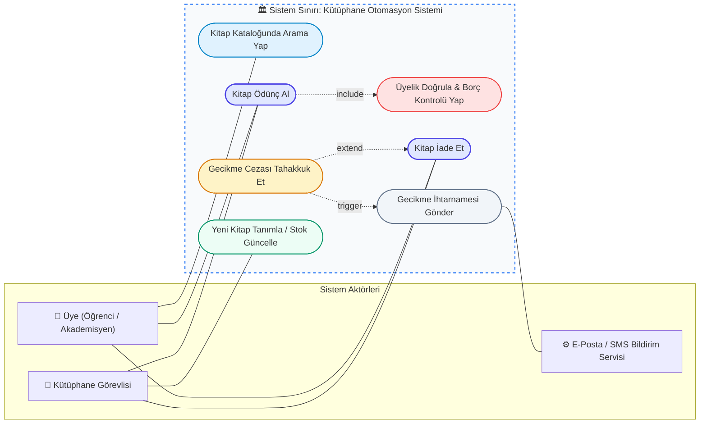
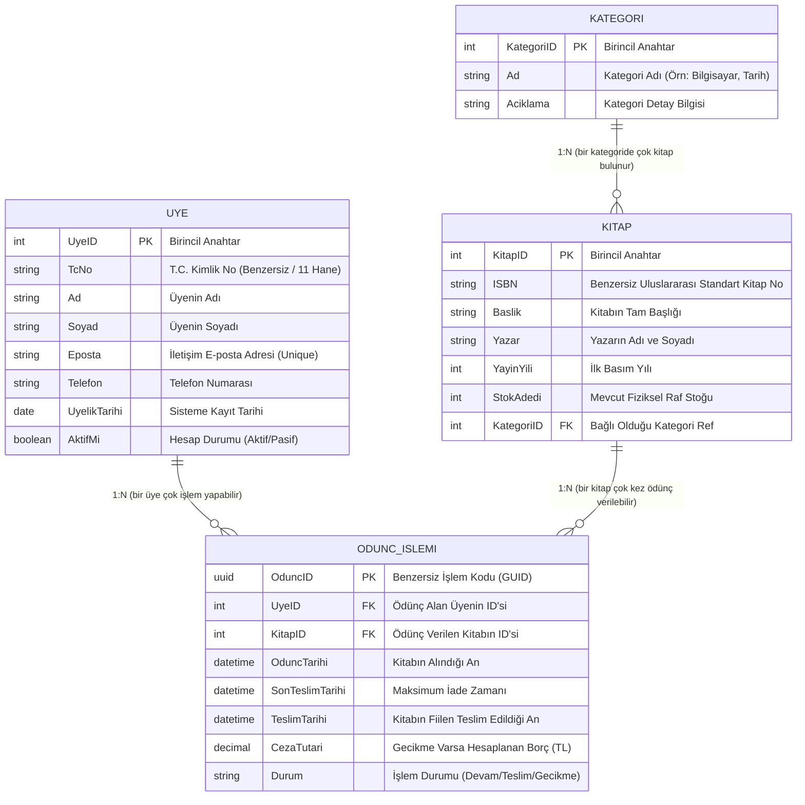
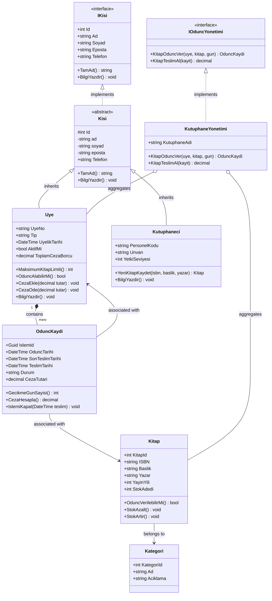

# Web Programcılığı III — Yazılım Mimarisi ve Modelleme Ödevi
## UML Modelleme Kılavuzu: Use Case, ER ve Class Diyagramları

> **Ders:** Web Programcılığı III  
> **Konu:** Yazılım Mühendisliğinde Görsel Modelleme Dilleri (UML 2.5) ve İlişkisel Veri Tabanı Tasarımı  
> **Örnek Senaryo:** Kapsamlı Kütüphane Otomasyon Sistemi (Library Management System)  
> **Uygulama Dili:** C# (.NET 8 / OOP)  
> **Canlı Görsel Sunum:** [`index.html`](./index.html) (Mermaid Canlı Grafik Çizimi & PDF Desteği)

---

## 📑 İçindekiler
1. [UML (Unified Modeling Language) Nedir?](#1-uml-unified-modeling-language-nedir)
   - [Tanımı ve Doğuşu](#tanımı-ve-doğuşu)
   - [Yazılım Mühendisliğindeki Önemi ve Avantajları](#yazılım-mühendisliğindeki-önemi-ve-avantajları)
   - [UML 2.5 Diyagram Sınıflandırması](#uml-25-diyagram-sınıflandırması)
2. [Use Case (Kullanım Senaryosu) Diyagramı](#2-use-case-kullanım-senaryosu-diyagramı)
   - [Kavramsal Tanım ve Rolü](#kavramsal-tanım-ve-rolü)
   - [Temel Bileşenler (Actor, Use Case, System Boundary)](#temel-bileşenler)
   - [İlişki Tipleri (Association, <<include>>, <<extend>>, Generalization)](#ilişki-tipleri)
   - [Kütüphane Sistemi Use Case Mermaid Diyagramı](#kütüphane-sistemi-use-case-diyagramı)
   - [İş Kuralları ve Senaryo Analizi](#iş-kuralları-ve-senaryo-analizi)
3. [ER (Entity-Relationship) Diyagramı](#3-er-entity-relationship-diyagramı)
   - [Kavramsal Tanım ve Veri Tabanı Mimarisi](#kavramsal-tanım-ve-veri-tabanı-mimarisi)
   - [Temel Bileşenler (Entity, Attribute, PK, FK)](#er-temel-bileşenler)
   - [Kardinalite ve İlişki Türleri (1:1, 1:N, M:N ve Junction Table)](#kardinalite-ve-ilişki-türleri)
   - [Kütüphane Sistemi ER Mermaid Diyagramı](#kütüphane-sistemi-er-diyagramı)
   - [Veri Tabanı Tablo ve Alan Detayları](#veri-tabanı-tablo-ve-alan-detayları)
4. [Class (Sınıf) Diyagramı](#4-class-sınıf-diyagramı)
   - [Kavramsal Tanım ve OOP ile Bağıntısı](#kavramsal-tanım-ve-oop-ile-bağıntısı)
   - [Erişim Belirleyiciler (Access Modifiers)](#erişim-belirleyiciler)
   - [OOP Prensipleri ve UML İlişkileri](#oop-prensipleri-ve-uml-ilişkileri)
     - [Encapsulation, Inheritance, Association, Aggregation, Composition](#ilişki-türleri-ve-gösterimleri)
   - [Kütüphane Sistemi Class Mermaid Diyagramı](#kütüphane-sistemi-class-diyagramı)
5. [C# Nesne Yönelimli Kod Uygulaması](#5-c-nesne-yönelimli-kod-uygulaması)
   - [Mimari Yapı ve Tasarım Prensipleri](#mimari-yapı-ve-tasarım-prensipleri)
   - [`KutuphaneModel.cs` Tam Kaynak Kodu](#kutuphanemodelcs-tam-kaynak-kodu)
6. [Diyagramların Karşılaştırma Matrisi](#6-diyagramların-karşılaştırma-matrisi)
7. [Çalıştırma ve Web/PDF Arayüzü](#7-çalıştırma-ve-webpdf-arayüzü)
8. [Akademik Kaynakça](#8-akademik-kaynakça)

---

## 1. UML (Unified Modeling Language) Nedir?

### Tanımı ve Doğuşu
**UML (Birleşik Modelleme Dili)**; yazılım yoğun sistemlerin mimarisini, analizini, tasarımını ve uygulama adımlarını **görselleştirmek**, **belirtmek (specify)**, **inşa etmek (construct)** ve **belgelemek (document)** amacıyla geliştirilmiş uluslararası standart genel amaçlı bir modelleme dilidir.

1990'ların ortasında yazılım dünyasındaki yöntem karmaşasını ("Method Wars") sonlandırmak adına, nesne yönelimli analiz ve tasarımın öncüsü kabul edilen **"Üç Amigo"** (Grady Booch, Ivar Jacobson ve James Rumbaugh) tarafından Rational Software bünyesinde geliştirilmiş, 1997 yılında **OMG (Object Management Group)** tarafından resmi standart olarak kabul edilmiştir. Günümüzde ISO/IEC 19505 standardı altında UML 2.5 sürümüyle varlığını sürdürmektedir.

### Yazılım Mühendisliğindeki Önemi ve Avantajları
1. **Ortak İletişim Dili (Lingua Franca):**  
   Müşteriler, ürün sahipleri (Product Owner), iş analistleri, yazılım mimarları, backend/frontend geliştiriciler ve veritabanı yöneticileri arasında teknik terimlerin ötesinde net ve görsel bir diyalog kurulmasını sağlar.
2. **Teknik Borcun (Technical Debt) Önlenmesi:**  
   Kodlama başlamadan önce mimarideki tasarım hatalarını, mantık boşluklarını ve döngüsel bağımlılıkları (circular dependencies) erken safhada ortaya çıkarır. Erken aşamada yakalanan bir tasarım hatasının düzeltme maliyeti, canlıya alınmış bir sistemdeki düzeltme maliyetinden onlarca kat daha düşüktür.
3. **Soyutlama (Abstraction) Yeteneği:**  
   Milyonlarca satırlık devasa kod tabanlarının karmaşıklığını yönetebilmek için detayları soyutlayarak sistemin yüksek seviyeli kuş bakışı görünümünü sunar.
4. **İleri ve Tersine Mühendislik (Forward & Reverse Engineering):**  
   UML diyagramlarından otomatik kaynak kod iskeleti üretilebilir (Forward Engineering) veya mevcut bir kod tabanı taranarak güncel mimari diyagramlar çıkarılabilir (Reverse Engineering).

### UML 2.5 Diyagram Sınıflandırması
UML 2.5 standardı bünyesinde **14 farklı diyagram türü** barındırır ve bunlar iki temel üst kategoriye ayrılır:

```
                            ┌─────────────────────────────────────────┐
                            │           UML 2.5 DİYAGRAMLARI          │
                            └────────────────────┬────────────────────┘
                                                 │
                   ┌─────────────────────────────┴─────────────────────────────┐
                   ▼                                                           ▼
       ┌────────────────────────┐                                 ┌────────────────────────┐
       │   YAPISAL DİYAGRAMLAR  │                                 │ DAVRANIŞSAL DİYAGRAMLAR│
       │ (Structural Diagrams)  │                                 │ (Behavioral Diagrams)  │
       └───────────┬────────────┘                                 └───────────┬────────────┘
                   │                                                           │
       ├─ Class (Sınıf)                                            ├─ Use Case (Kullanım Senaryosu)
       ├─ Object (Nesne)                                           ├─ Activity (Aktivite)
       ├─ Component (Bileşen)                                      ├─ State Machine (Durum Makinesi)
       ├─ Deployment (Dağıtım)                                     │
       ├─ Package (Paket)                                          └─ ETKİLEŞİM DİYAGRAMLARI (Alt Grup)
       ├─ Composite Structure                                          ├─ Sequence (Sıralama)
       └─ Profile                                                      ├─ Communication (İletişim)
                                                                       ├─ Timing (Zamanlama)
                                                                       └─ Interaction Overview
```

* **Yapısal (Statik) Diyagramlar:** Sistemin zamanda değişmeyen statik bileşenlerini, sınıflarını, arayüzlerini ve donanım/yazılım dağıtım düğümlerini gösterir.
* **Davranışsal (Dinamik) Diyagramlar:** Sistemin çalışma zamanındaki davranışını, nesnelerin durum geçişlerini ve kullanıcılarla olan fonksiyonel veri akışını gösterir.

---

## 2. Use Case (Kullanım Senaryosu) Diyagramı

### Kavramsal Tanım ve Rolü
Use Case diyagramları, sistemin dış dünya ile olan **fonksiyonel sınırlarını** ve aktörlerin sistem üzerinden hangi hedeflere ulaşabildiğini gösteren davranışsal bir diyagram türüdür. Sistemin "nasıl" çalıştığıyla değil, aktörlere **"ne"** sunduğuyla ilgilenir. Yazılım Geliştirme Yaşam Döngüsünün (SDLC) **Gereksinim Analizi (Requirement Engineering)** aşamasında en kritik rolü üstlenir.

### Temel Bileşenler
1. **Aktör (Actor):**  
   Sistemle etkileşime giren insan rolü, harici servis, donanım birimi veya zamanlayıcı tetikleyicidir. Çöp adam (stick man) sembolü ile temsil edilir. Birincil (Primary - senaryoyu başlatan) ve İkincil (Secondary - sisteme destek veren) olarak ayrılır.
2. **Kullanım Senaryosu (Use Case):**  
   Aktör için ölçülebilir bir değer veya sonuç üreten işlevsel işlem adımları dizisidir. Yatay elips içinde bir eylem fiili ile adlandırılır (Örn: *Kitap Ödünç Al*).
3. **Sistem Sınırı (System Boundary):**  
   Geliştirilen yazılımın kapsamını belirleyen büyük dikdörtgen kutudur. Use Case'ler kutunun içinde, Aktörler ise dışarısında konumlandırılır.

### İlişki Tipleri
* **Association (İlişkilendirme):** Aktör ile Use Case arasındaki doğrudan iletişim yolunu gösteren düz çizgidir.
* **`<<include>>` (Kapsama - Zorunlu Bağımlılık):**  
  Bir Use Case'in başarılı şekilde tamamlanabilmesi için başka bir alt Use Case'i **koşulsuz ve zorunlu** olarak çalıştırması gerektiğini ifade eder. Ok yönü ana senaryodan dahil edilen senaryoya doğrudur (`Ana --> <<include>> --> Dahil`).
  * *Örnek:* "Kitap Ödünç Al" senaryosu her çalıştığında mutlaka "Üyelik ve Borç Kontrolü" senaryosunu işletmek zorundadır.
* **`<<extend>>` (Genişletme - İsteğe Bağlı Bağımlılık):**  
  Belirli bir koşul (Extension Point) sağlandığında temel senaryoya eklenen opsiyonel davranışı modeller. Ok yönü genişleten senaryodan ana senaryoya doğrudur (`Opsiyonel --> <<extend>> --> Temel`).
  * *Örnek:* "Kitap İade Et" eyleminde, eğer teslim süresi aşılmışsa ek olarak "Gecikme Cezası Hesapla" devreye girer; gününde teslimde bu senaryo çalışmaz.
* **Generalization (Genelleştirme / Miras):**  
  Aktörler veya senaryolar arasındaki "is-a" (türüdür) ilişkisidir. İçi boş ok ile gösterilir.

### Kütüphane Sistemi Use Case Diyagramı

Aşağıdaki Mermaid diyagramında, modern bir Kütüphane Otomasyon Sisteminin aktörleri (`Üye`, `Kütüphane Görevlisi`, `Bildirim Servisi`), sistem sınırları ve senaryolar arası `<<include>>` / `<<extend>>` bağlantıları modellenmiştir:



### İş Kuralları ve Senaryo Analizi
1. **Kitap Ödünç Alma:** Üye ve Görevli birlikte bu süreci yönetebilir. İşlem gerçekleşmeden önce sistem `<<include>>` bağıntısıyla üyenin aktif borcunun olup olmadığını ve limitini denetler.
2. **Kitap İade Etme:** Kitap zamanında iade edilirse doğrudan stok artırılır. Ancak teslim süresi aşılmışsa, `<<extend>>` kuralı tetiklenerek geciken gün başına ceza kesilir ve harici servis üzerinden üyeye ihtarname iletilir.

---

## 3. ER (Entity-Relationship) Diyagramı

### Kavramsal Tanım ve Veri Tabanı Mimarisi
ER diyagramı (Varlık-İlişki Modeli), 1976 yılında **Peter Chen** tarafından ortaya konulan, veritabanında saklanacak verilerin kavramsal ve mantıksal şemasını tanımlayan modelleme tekniğidir. Yazılımın bellek üzerindeki sınıflarından ziyade, diskte kalıcı (persistent) olarak tutulacak ilişkisel tabloları ve referans bütünlüklerini (Referential Integrity) hedefler.

### ER Temel Bileşenler
* **Entity (Varlık):** Bilgi toplanan, birbirinden ayırt edilebilir nesnelerdir. İlişkisel veritabanındaki **tablolara (Tables)** karşılık gelir.
* **Attribute (Nitelik):** Varlığın her bir özelliğidir. Tablolardaki **kolonlara (Columns)** karşılık gelir.
* **Primary Key (PK - Birincil Anahtar):** Tablodaki her bir satırı benzersiz biçimde tanımlayan tekil alandır.
* **Foreign Key (FK - Yabancı Anahtar):** Bir tablonun başka bir tablodaki PK alanına referans vererek aralarında mantıksal bağ kurmasını sağlayan anahtardır.

### Kardinalite ve İlişki Türleri
1. **1:1 (Bire-Bir):** Bir tablodaki bir kayıt, diğer tablodaki en fazla bir kayıtla eşleşir (Örn: Üye ile Kütüphane Kartı Detayı).
2. **1:N (Bire-Çok):** Bir ana tablodaki tek bir kayıt, hedef tablodaki birden fazla kayıtla ilişkilenir (Örn: Bir `KATEGORI` altında birden çok `KITAP` bulunabilir).
3. **M:N (Çoka-Çok):** Bir üye birçok kitap ödünç alabilir, bir kitap da zaman içerisinde birçok üye tarafından ödünç alınabilir. İlişkisel veritabanları (RDBMS) M:N ilişkileri doğrudan desteklemez; bu ilişki **Ara Tablo (Junction / Associative Entity)** olan `ODUNC_ISLEMI` tablosu vasıtasıyla iki adet **1:N** ilişkiye dönüştürülerek normalizasyon kurallarına (3NF) uygun hale getirilir.

### Kütüphane Sistemi ER Diyagramı

Aşağıda Kütüphane Veritabanı için `KATEGORI`, `KITAP`, `UYE` ve `ODUNC_ISLEMI` tablolarının ilişkilerini ve veri tiplerini içeren Mermaid ER diyagramı yer almaktadır:



### Veri Tabanı Tablo ve Alan Detayları

| Tablo Adı | Birincil Anahtar (PK) | Yabancı Anahtar (FK) | Açıklama |
|---|---|---|---|
| **`KATEGORI`** | `KategoriID` | Yok | Kitapların konu bazlı gruplandırılması (Edebiyat, Mühendislik vb.). |
| **`KITAP`** | `KitapID` | `KategoriID` -> `KATEGORI` | Kütüphanedeki eserlerin fiziksel ve bibliyografik künye kayıtları. |
| **`UYE`** | `UyeID` | Yok | Kütüphaneden hizmet alan okuyucuların kimlik ve iletişim verileri. |
| **`ODUNC_ISLEMI`** | `OduncID` | `UyeID` -> `UYE`<br>`KitapID` -> `KITAP` | **Junction Table:** Üye ile Kitap arasındaki çoktan-çoğa (M:N) ödünç alma geçmişini saklar. |

---

## 4. Class (Sınıf) Diyagramı

### Kavramsal Tanım ve OOP ile Bağıntısı
Sınıf (Class) diyagramı, Nesne Yönelimli Programlamanın (OOP) kalbidir. Sistemin statik yapısını nesneler, sınıflar, arayüzler (interfaces), nitelikler (fields/properties), metotlar ve sınıflar arası bağlar düzeyinde modeller. Kaynak koda en yakın UML diyagramıdır.

### Erişim Belirleyiciler (Access Modifiers)
UML standardında sınıfların üyeleri önlerine gelen özel sembollerle erişim sınırlarını belirtir:
* **`+` (Public):** Herhangi bir sınıftan veya dışarıdan serbestçe erişilebilir.
* **`-` (Private):** Yalnızca tanımlandığı sınıfın gövdesi içerisinden erişilebilir (Kapsülleme esası).
* **`#` (Protected):** Tanımlandığı sınıf ve ondan türeyen alt sınıflar (Derived Classes) tarafından erişilebilir.
* **`~` (Package / Internal):** Yalnızca aynı modül / namespace / derleme içerisinden erişilebilir.

### OOP Prensipleri ve UML İlişkileri
1. **Encapsulation (Kapsülleme):**  
   Verilerin doğrudan dış müdahalelerden gizlenmesi (`- private`) ve kontrollü erişim sağlayan metotlar/özellikler (`+ public get/set`) ile yönetilmesidir.
2. **Inheritance (Kalıtım / Miras - Generalization):**  
   Ortak nitelik ve yeteneklerin bir üst sınıfta (Base Class) toplanıp alt sınıflara aktarılmasıdır. UML'de **içi boş üçgen oklu düz çizgi** (`<|--`) ile gösterilir.
   * *Örnek:* `Kisi` soyut sınıfından `Uye` ve `Kutuphaneci` sınıflarının türetilmesi.
3. **Association (Birliktelik / Kullanım):**  
   İki sınıf arasındaki "kullanır" seviyesindeki gevşek bağdır. Düz bir çizgi veya yönlü ok ile gösterilir.
   * *Örnek:* `OduncKaydi` nesnesinin bir `Uye` ve `Kitap` nesnesine referans bulundurması.
4. **Aggregation (Bütünleme / Zayıf Parça-Bütün):**  
   "Has-a" (sahiptir) ilişkisidir. Parça, bütünden bağımsız olarak kendi yaşam döngüsünü sürdürebilir. UML'de **içi boş eşkenar dörtgen** (`o--`) ile gösterilir.
   * *Örnek:* Bir kütüphane kapansa veya yok olsa dahi kitaplar varlığını sürdürür (`Kutuphane o-- Kitap`).
5. **Composition (Bileşim / Güçlü Parça-Bütün):**  
   Parçanın varlığı bütüne sıkı sıkıya bağlıdır. Bütün yok edilirse parça da yok olur (Ömür döngüsü bağımlılığı). UML'de **içi dolu siyah eşkenar dörtgen** (`*--`) ile gösterilir.
   * *Örnek:* Bir üyenin aktif işlem sepeti veya faturanın satır kalemleri.

### Kütüphane Sistemi Class Mermaid Diyagramı



---

## 5. C# Nesne Yönelimli Kod Uygulaması

### Mimari Yapı ve Tasarım Prensipleri
Hazırlanan C# kod tabanı (`KutuphaneModel.cs`), yukarıdaki sınıf diyagramındaki mimariyi birebir kod düzeyinde somutlaştırmaktadır:
* **SOLID - Tek Sorumluluk Prensibi (SRP):** Her sınıf kendi alanından sorumludur (`OduncKaydi` yalnızca ödünç süresi ve ceza hesabını bilir, kullanıcı listesini bilmez).
* **SOLID - Açık/Kapalı Prensibi (OCP):** `Kisi` sınıfı genişlemeye açık (`virtual` metotlar), değişime kapalıdır.
* **Polimorfizm:** `BilgiYazdir()` sanal metodu alt sınıflarda (`Uye`, `Kutuphaneci`) `override` edilerek özelleştirilmiştir.
* **Kapsülleme:** Private alanlar backing field olarak tutulmuş, geçersiz veri girişine karşı property set bloklarında `ArgumentException` fırlatılmıştır.

### `KutuphaneModel.cs` Tam Kaynak Kodu
> Bu dosya repo kök dizininde [`KutuphaneModel.cs`](./KutuphaneModel.cs) olarak yer almaktadır.

```csharp
using System;
using System.Collections.Generic;
using System.Linq;

namespace KutuphaneOtomasyonu
{
    public enum OduncDurumu { DevamEdiyor, TeslimEdildi, Gecikmede, IptalEdildi }
    public enum UyelikTipi { Ogrenci, Akademisyen, IdariPersonel, Genel }

    public interface IKisi
    {
        int Id { get; }
        string Ad { get; set; }
        string Soyad { get; set; }
        string Eposta { get; set; }
        string Telefon { get; set; }
        string TamAd();
        void BilgiYazdir();
    }

    public interface IOduncYonetimi
    {
        OduncKaydi KitapOduncVer(Uye uye, Kitap kitap, int oduncGunu = 15);
        decimal KitapTeslimAl(OduncKaydi oduncKaydi);
    }

    public abstract class Kisi : IKisi
    {
        private string _ad;
        private string _soyad;
        private string _eposta;

        public int Id { get; protected set; }
        public string Ad
        {
            get => _ad;
            set => _ad = !string.IsNullOrWhiteSpace(value) ? value.Trim() : throw new ArgumentException("Ad boş olamaz.");
        }
        public string Soyad
        {
            get => _soyad;
            set => _soyad = !string.IsNullOrWhiteSpace(value) ? value.Trim() : throw new ArgumentException("Soyad boş olamaz.");
        }
        public string Eposta
        {
            get => _eposta;
            set => _eposta = (!string.IsNullOrWhiteSpace(value) && value.Contains("@")) ? value.Trim() : throw new ArgumentException("Geçersiz e-posta.");
        }
        public string Telefon { get; set; }

        protected Kisi(int id, string ad, string soyad, string eposta, string telefon)
        {
            Id = id; Ad = ad; Soyad = soyad; Eposta = eposta; Telefon = telefon;
        }

        public virtual string TamAd() => $"{Ad} {Soyad}";
        public virtual void BilgiYazdir() => Console.WriteLine($"[ID: {Id}] {TamAd()} | E-posta: {Eposta} | Tel: {Telefon}");
    }

    public class Uye : Kisi
    {
        public string UyeNo { get; private set; }
        public UyelikTipi Tip { get; set; }
        public DateTime UyelikTarihi { get; private set; }
        public bool AktifMi { get; set; }
        public decimal ToplamCezaBorcu { get; private set; }
        public List<OduncKaydi> AktifOduncler { get; private set; }

        public Uye(int id, string ad, string soyad, string eposta, string telefon, string uyeNo, UyelikTipi tip)
            : base(id, ad, soyad, eposta, telefon)
        {
            UyeNo = uyeNo; Tip = tip; UyelikTarihi = DateTime.Now; AktifMi = true;
            ToplamCezaBorcu = 0.0m; AktifOduncler = new List<OduncKaydi>();
        }

        public int MaksimumKitapLimiti() => Tip switch
        {
            UyelikTipi.Akademisyen => 10,
            UyelikTipi.Ogrenci => 5,
            _ => 3
        };

        public bool OduncAlabilirMi() => AktifMi && ToplamCezaBorcu <= 50.0m && AktifOduncler.Count < MaksimumKitapLimiti();
        public void CezaEkle(decimal tutar) { if (tutar > 0) ToplamCezaBorcu += tutar; }
        public void CezaOde(decimal tutar) { if (tutar > 0) ToplamCezaBorcu = Math.Max(0, ToplamCezaBorcu - tutar); }

        public override void BilgiYazdir()
        {
            base.BilgiYazdir();
            Console.WriteLine($"\t-> Üye No: {UyeNo} | Limit: {AktifOduncler.Count}/{MaksimumKitapLimiti()} | Borç: {ToplamCezaBorcu:C2}");
        }
    }

    public class Kutuphaneci : Kisi
    {
        public string PersonelKodu { get; private set; }
        public string Unvan { get; set; }
        public int YetkiSeviyesi { get; set; }

        public Kutuphaneci(int id, string ad, string soyad, string eposta, string telefon, string personelKodu, string unvan, int yetki = 1)
            : base(id, ad, soyad, eposta, telefon)
        {
            PersonelKodu = personelKodu; Unvan = unvan; YetkiSeviyesi = yetki;
        }

        public Kitap YeniKitapKaydet(string isbn, string baslik, string yazar, int yayinYili, int stok, Kategori kat)
        {
            return new Kitap(new Random().Next(1000, 9999), isbn, baslik, yazar, yayinYili, stok, kat);
        }
    }

    public class Kategori
    {
        public int KategoriId { get; set; }
        public string Ad { get; set; }
        public string Aciklama { get; set; }
        public Kategori(int id, string ad, string aciklama = "") { KategoriId = id; Ad = ad; Aciklama = aciklama; }
    }

    public class Kitap
    {
        public int KitapId { get; private set; }
        public string ISBN { get; private set; }
        public string Baslik { get; set; }
        public string Yazar { get; set; }
        public int YayinYili { get; set; }
        public int StokAdedi { get; private set; }
        public Kategori Kategori { get; set; }

        public Kitap(int id, string isbn, string baslik, string yazar, int yayinYili, int stok, Kategori kategori)
        {
            KitapId = id; ISBN = isbn; Baslik = baslik; Yazar = yazar; YayinYili = yayinYili;
            StokAdedi = Math.Max(0, stok); Kategori = kategori;
        }

        public bool OduncVerilebilirMi() => StokAdedi > 0;
        public void StokAzalt() { if (StokAdedi <= 0) throw new InvalidOperationException("Stok bitti."); StokAdedi--; }
        public void StokArtir() => StokAdedi++;
    }

    public class OduncKaydi
    {
        public Guid IslemId { get; private set; }
        public Uye Uye { get; private set; }
        public Kitap Kitap { get; private set; }
        public DateTime OduncTarihi { get; private set; }
        public DateTime SonTeslimTarihi { get; private set; }
        public DateTime? TeslimTarihi { get; private set; }
        public OduncDurumu Durum { get; private set; }
        public decimal CezaTutari { get; private set; }
        public const decimal GunlukGecikmeCezasi = 5.0m;

        public OduncKaydi(Uye uye, Kitap kitap, int gun = 15)
        {
            IslemId = Guid.NewGuid(); Uye = uye; Kitap = kitap;
            OduncTarihi = DateTime.Now; SonTeslimTarihi = OduncTarihi.AddDays(gun);
            Durum = OduncDurumu.DevamEdiyor;
        }

        public int GecikmeGunSayisi(DateTime kontrol)
        {
            var kapanis = TeslimTarihi ?? kontrol;
            return (kapanis > SonTeslimTarihi) ? (int)Math.Ceiling((kapanis - SonTeslimTarihi).TotalDays) : 0;
        }

        public decimal CezaHesapla(DateTime kontrol)
        {
            CezaTutari = GecikmeGunSayisi(kontrol) * GunlukGecikmeCezasi;
            return CezaTutari;
        }

        public void IslemiKapat(DateTime teslimTarihi)
        {
            TeslimTarihi = teslimTarihi;
            decimal ceza = CezaHesapla(teslimTarihi);
            if (ceza > 0) { Durum = OduncDurumu.Gecikmede; Uye.CezaEkle(ceza); }
            else { Durum = OduncDurumu.TeslimEdildi; }
            Kitap.StokArtir();
            Uye.AktifOduncler.Remove(this);
        }
    }

    public class KutuphaneYonetimi : IOduncYonetimi
    {
        public string KutuphaneAdi { get; set; }
        public List<Kitap> Envanter { get; private set; } = new();
        public List<Uye> Uyeler { get; private set; } = new();
        public List<Kutuphaneci> Personeller { get; private set; } = new();
        public List<OduncKaydi> TumOduncKayitlari { get; private set; } = new();

        public KutuphaneYonetimi(string ad) { KutuphaneAdi = ad; }

        public OduncKaydi KitapOduncVer(Uye uye, Kitap kitap, int oduncGunu = 15)
        {
            if (!uye.OduncAlabilirMi()) throw new InvalidOperationException("Üye limiti dolu veya borcu var.");
            if (!kitap.OduncVerilebilirMi()) throw new InvalidOperationException("Kitap stokta yok.");

            kitap.StokAzalt();
            var kayit = new OduncKaydi(uye, kitap, oduncGunu);
            uye.AktifOduncler.Add(kayit);
            TumOduncKayitlari.Add(kayit);
            return kayit;
        }

        public decimal KitapTeslimAl(OduncKaydi kayit)
        {
            kayit.IslemiKapat(DateTime.Now);
            return kayit.CezaTutari;
        }
    }
}
```

---

## 6. Diyagramların Karşılaştırma Matrisi

Yazılım geliştirme sürecinde her diyagram sistemin farklı bir perspektifine ışık tutar. Aşağıdaki matris Use Case, ER ve Class diyagramlarının mimari ayrımlarını özetlemektedir:

| Karşılaştırma Kriteri | Use Case Diyagramı | ER (Varlık-İlişki) Diyagramı | Class (Sınıf) Diyagramı |
|---|---|---|---|
| **Ana Odak Noktası** | Sistemin sunduğu fonksiyonlar ve aktör etkileşimi ("NE yapılıyor?") | Verilerin kalıcı depolanma yapısı ve ilişkileri ("VERİ nedir?") | Yazılımın nesne mimarisi, mantığı ve metotları ("NASIL kodlanacak?") |
| **SDLC Aşaması** | **Gereksinim Analizi** (Başlangıç fazı) | **Veritabanı Tasarımı** (Veri katmanı analizi) | **Detaylı Tasarım & Kodlama** (Uygulama fazı) |
| **UML / Standart Türü** | UML Davranışsal (Behavioral) | Peter Chen Modeli / Veritabanı Standardı | UML Yapısal (Structural) |
| **Hedef Kitle** | Müşteri, İş Analisti, Son Kullanıcı, Yazılımcı | Veritabanı Yöneticisi (DBA), Backend Geliştirici | Yazılım Mimarı, Yazılım Geliştirici |
| **Temel Bileşenler** | Aktör, Use Case, Sistem Sınırı, Include, Extend | Varlık (Entity), Nitelik (Attribute), PK, FK | Sınıf, Arayüz, Metot, Alan, Property |
| **İlişki Türleri** | Association, `<<include>>`, `<<extend>>`, Generalization | 1:1, 1:N, M:N (Kardinalite, Referans Bütünlüğü) | Inheritance, Association, Aggregation, Composition |
| **İş Mantığı & Metot** | İş mantığı barındırmaz, kullanıcı hedefini listeler. | Metot/davranış barındırmaz, salt veri ve veri tipleri vardır. | Hem veri niteliklerini hem de iş mantığı yürüten **metotları** içerir. |
| **Bellek vs Disk** | Kavramsal kullanıcı etkileşimidir. | **Diskte** kalıcı (RDBMS / Tablo) yapıyı tanımlar. | **RAM'de** yaşayan nesneleri (OOP Nesne Grafı) tanımlar. |

---

## 7. Çalıştırma ve Web/PDF Arayüzü

Bu ödev, tarayıcı üzerinden interaktif olarak incelenebilmesi ve tek bir tıkla akademik PDF raporu formatında yazdırılabilmesi için modern bir arayüzle donatılmıştır:

* **Web Arayüzü:** [`index.html`](./index.html) dosyasını herhangi bir modern tarayıcıda açabilirsiniz.
* **Canlı Çizim:** Mermaid kütüphanesi CDN üzerinden dinamik olarak yüklenir ve tüm diyagramları SVG vektörel grafik olarak çizer.
* **Karanlık / Aydınlık Tema:** Sağ üstteki buton üzerinden anında tema değiştirebilirsiniz.
* **Tek Tıkla PDF:** "PDF / Rapor Çıktısı Al" butonu ile sayfa otomatik olarak yazdırma ve PDF formatına optimize edilir (gereksiz butonlar gizlenir, diyagramlar sayfaya tam oturur).

---

## 8. Akademik Kaynakça

1. **Booch, G., Rumbaugh, J., & Jacobson, I. (2005).** *The Unified Modeling Language User Guide (2nd Edition).* Addison-Wesley Professional.
2. **Object Management Group (OMG). (2015).** *OMG Unified Modeling Language (OMG UML) Specification, Version 2.5.* formal/2015-03-01.
3. **Chen, P. P. (1976).** *The Entity-Relationship Model—Toward a Unified View of Data.* ACM Transactions on Database Systems (TODS), 1(1), 9-36.
4. **Fowler, M. (2003).** *UML Distilled: A Brief Guide to the Standard Object Modeling Language (3rd Edition).* Addison-Wesley Professional.
5. **Martin, R. C. (2008).** *Clean Code: A Handbook of Agile Software Craftsmanship.* Prentice Hall.
6. **Larman, C. (2004).** *Applying UML and Patterns: An Introduction to Object-Oriented Analysis and Design and Iterative Development (3rd Edition).* Prentice Hall.
