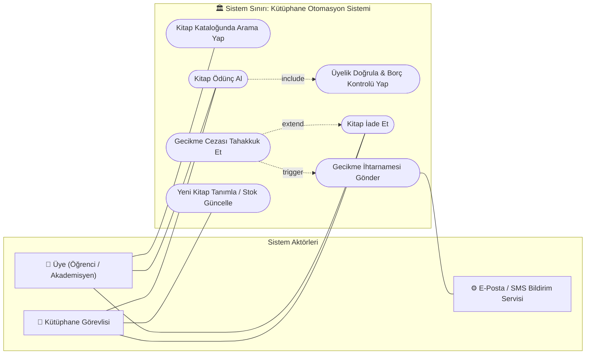
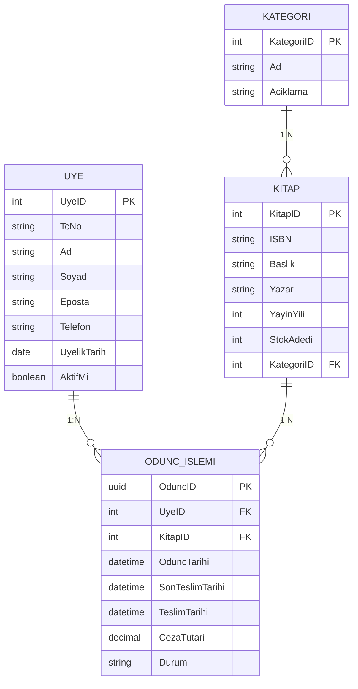
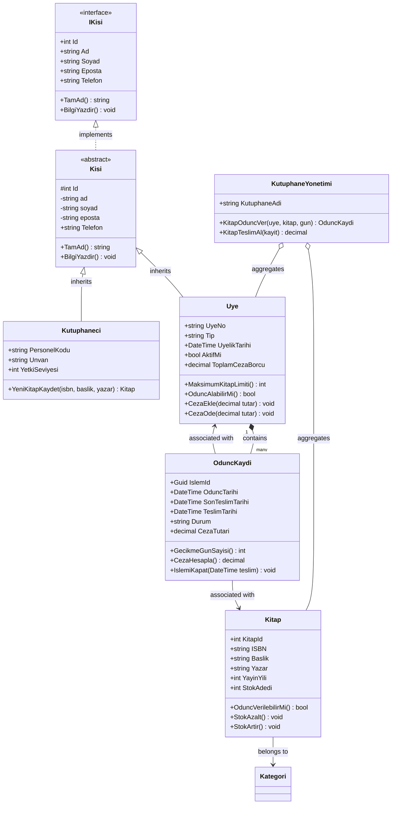

# Web Programcılığı III — Yazılım Mimarisi ve Modelleme Ödevi
## UML Modelleme Kılavuzu: Use Case, ER ve Class Diyagramları

> **Ders:** Web Programcılığı III  
> **Konu:** Yazılım Mühendisliğinde Görsel Modelleme Dilleri (UML 2.5) ve İlişkisel Veri Tabanı Tasarımı  
> **Örnek Senaryo:** Kapsamlı Kütüphane Otomasyon Sistemi (Library Management System)  
> **Uygulama Dili:** C# (.NET 8 / OOP)  
> **Canlı Görsel Sunum:** [`index.html`](./index.html)

---

## 📑 İçindekiler
1. [UML (Unified Modeling Language) Nedir?](#1-uml-unified-modeling-language-nedir)
2. [Use Case (Kullanım Senaryosu) Diyagramı](#2-use-case-kullanım-senaryosu-diyagramı)
3. [ER (Entity-Relationship) Diyagramı](#3-er-entity-relationship-diyagramı)
4. [Class (Sınıf) Diyagramı](#4-class-sınıf-diyagramı)
5. [C# Nesne Yönelimli Kod Uygulaması](#5-c-nesne-yönelimli-kod-uygulaması)
6. [Diyagramların Karşılaştırma Matrisi](#6-diyagramların-karşılaştırma-matrisi)
7. [Akademik Kaynakça](#7-akademik-kaynakça)

---

## 1. UML (Unified Modeling Language) Nedir?

### Tanımı ve Doğuşu
**UML (Birleşik Modelleme Dili)**; yazılım yoğun sistemlerin mimarisini, analizini, tasarımını ve uygulama adımlarını **görselleştirmek**, **belirtmek (specify)**, **inşa etmek (construct)** ve **belgelemek (document)** amacıyla geliştirilmiş uluslararası standart genel amaçlı bir modelleme dilidir.

1990'ların ortasında yazılım dünyasındaki yöntem karmaşasını sonlandırmak adına, nesne yönelimli analiz ve tasarımın öncüsü kabul edilen **"Üç Amigo"** (Grady Booch, Ivar Jacobson ve James Rumbaugh) tarafından Rational Software bünyesinde geliştirilmiş, 1997 yılında **OMG (Object Management Group)** tarafından resmi standart olarak kabul edilmiştir. Günümüzde ISO/IEC 19505 standardı altında UML 2.5 sürümüyle varlığını sürdürmektedir.

### Yazılım Mühendisliğindeki Önemi ve Avantajları
1. **Ortak İletişim Dili (Lingua Franca):** Müşteriler, analistler, yazılım mimarları ve geliştiriciler arasında ortak teknik anlayış kurar.
2. **Teknik Borcun (Technical Debt) Önlenmesi:** Hataları kodlamadan önce tasarım safhasında yakalayarak maliyeti düşürür.
3. **Soyutlama Yeteneği:** Sistemin yüksek seviyeli mimarisini karmaşıklıktan arındırarak sunar.
4. **İleri ve Tersine Mühendislik:** Koddan diyagram veya diyagramdan kod üretimini destekler.

### UML 2.5 Diyagram Sınıflandırması
* **Yapısal (Statik) Diyagramlar:** Class (Sınıf), Object (Nesne), Component (Bileşen), Deployment (Dağıtım), Package (Paket), Composite Structure, Profile.
* **Davranışsal (Dinamik) Diyagramlar:** Use Case (Kullanım Senaryosu), Activity (Aktivite), State Machine (Durum Makinesi), Sequence (Sıralama), Communication (İletişim), Timing (Zamanlama), Interaction Overview.

---

## 2. Use Case (Kullanım Senaryosu) Diyagramı

### Kütüphane Sistemi Use Case Mermaid Diyagramı

---

## 3. ER (Entity-Relationship) Diyagramı

---

## 4. Class (Sınıf) Diyagramı

---

## 5. C# Nesne Yönelimli Kod Uygulaması

Detaylı C# kaynak kodları için [`KutuphaneModel.cs`](./KutuphaneModel.cs) dosyasını inceleyebilirsiniz.

---

## 6. Diyagramların Karşılaştırma Matrisi

| Kriter | Use Case Diyagramı | ER Diyagramı | Class Diyagramı |
|---|---|---|---|
| **Ana Odak** | Sistem işlevleri ve aktör etkileşimi | Kalıcı veri şeması ve tablolar | Yazılım nesne yapısı, iş mantığı ve metotlar |
| **SDLC Safhası** | Gereksinim Analizi | Veritabanı Tasarımı | Mimari Tasarım & Kodlama |
| **Kategori** | UML Davranışsal | Chen Veri Modeli / RDBMS | UML Yapısal |
| **Bileşenler** | Aktör, Use Case, Include, Extend | Varlık, Nitelik, PK, FK | Sınıf, Alan, Metot, Interface |
| **Bellek Konumu** | Kavramsal hedef | Disk (Veritabanı Tablosu) | RAM (Nesne Örneği) |

---

## 7. Akademik Kaynakça
1. Booch, G., Rumbaugh, J., & Jacobson, I. (2005). *The Unified Modeling Language User Guide.*
2. OMG UML 2.5 Specification. (2015).
3. Chen, P. P. (1976). *The Entity-Relationship Model—Toward a Unified View of Data.*
4. Fowler, M. (2003). *UML Distilled (3rd Edition).*
